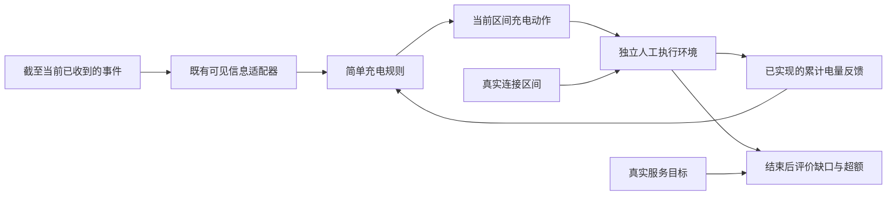

# 纯人工充电闭环：执行与需求评价

日期：2026-11-06。**人工工程检查已形成；真实数据、预测收益和配网运行价值尚未验证。**

本轮承接 [可见信息适配器](CONTROLLER_ADAPTER_OUTCOME_20261106.md)，追加到 [工程 PR #115](https://github.com/Kato814/EV-Charging-Forecasting-Research/pull/115)。总体论文框架仍为可调整的工作方案，见 [PR #114](https://github.com/Kato814/EV-Charging-Forecasting-Research/pull/114)；[字段审计 PR #116](https://github.com/Kato814/EV-Charging-Forecasting-Research/pull/116) 的历史记录保持原样。新增人工会话输入不改变旧 station-only 预测实验的输入限制。

## 1. 现在能做什么

程序已经可以按“看见信息 → 分配充电功率 → 实际交付 → 接收累计电量 → 再分配”的顺序运行。当前规则优先处理声明离站时间较早的车辆；相同时间按人工会话编号排序。



调度规则接收的只有可见视图、同步累计电量快照及显式手填功率上限。真实离站用于环境计算连接重叠时长；真实服务目标只用于最后评价，不能作为环境交付量的截断上限。改变目标不会改变物理反馈，从而避免把评价答案间接传回控制器。

每步执行前先检查整批动作。设备或充电组总上限、时间、身份、有限数值等不满足时，整个批次被拒绝，累计电量与时间游标均不改变。已执行区间不能再执行一遍。缺少反馈、需求语义不明或声明离站时间未对齐时，明确阻断对应会话。

## 2. 八个人工场景的结果

原始聚合观察值、时间、源码 SHA256 见 [L01–L08 报告](evidence/synthetic_charging_loop_checks_20261106.json)。这里的 PASS 表示程序符合预定检查行为，包括如实暴露充电缺口；不表示所有场景都充满。

| 场景 | 实际得到的结果 |
| --- | --- |
| L01 可满足 | 总上限 4 kW，A 需 0.5 kWh、15 分钟离站，B 需 1.5 kWh、30 分钟离站。先给 A/B 各 2 kW，再给 B 4 kW；共交付 2 kWh，缺口 0。 |
| L02 容量紧张 | 两车各需 2 kWh，均 30 分钟离站，总上限 4 kW；本规则交付 2 kWh，保留 2 kWh 缺口。 |
| L03 规则反例 | 同一组输入中，优先规则缺 1 kWh；另一个实际执行过的手工分配缺口为 0。规则产生缺口不等于问题不可行。 |
| L04 提前离站、通知迟到 | 6 kW 指令，真实只连接前 10 分钟，断开通知到第 30 分钟才收到。三步命令总功率为 6/6/0 kW，实际交付为 1/0/0 kWh；没有把未执行的命令算成充电量。 |
| L05 未知请求含义 | 会话被明确阻断、不发充电动作；评价仍记录 1 kWh 未满足需求。 |
| L06 未来真值隔离 | 仅改变真实服务目标，动作和交付序列完全相同，只改变最后的缺口/超额评价。未来离站变化在已知输入和已发生反馈仍相同的前缀内不影响动作。 |
| L07 非法动作 | 超上限批次被拒绝且状态不变；同一时点随后提交合法动作可以执行，重复执行同一区间被拒绝。 |
| L08 追加请求 | 先请求总量 2 kWh，第 15 分钟在已交付 2 kWh 基点上追加 5 kWh。功率依次 8/8/8/4 kW，总交付 7 kWh，无重复扣减。 |

### L03 为什么有用

设充电组总上限 8 kW。A 需 2 kWh、设备限 8 kW、30 分钟离站；B 需 3 kWh、设备限 4 kW、45 分钟离站。每步 15 分钟，两车从零时刻已连接，所有这些声明和上限均已知。

| 区间 | 简单规则 A/B 功率 | 手工可满足分配 A/B 功率 |
| --- | --- | --- |
| 0–15 分钟 | 8 / 0 kW | 4 / 4 kW |
| 15–30 分钟 | 0 / 4 kW | 4 / 4 kW |
| 30–45 分钟 | 0 / 4 kW | 0 / 4 kW |
| 最终交付 A/B | 2 / 2 kWh | 2 / 3 kWh |

两种分配都经同一个执行环境的设备、总功率及时间检查。B 必须利用三个区间才能完成 3 kWh，第一步完全让给 A 后就无法补回。这个例子用于检查基线和评价方法；它不是新算法，也不是论文创新或真实运行收益证据。

## 3. 明确的人工假设

- 样例步长 15 分钟、声明离站对齐控制网格、动作全步恒定且不在步内重新分配；真实离站可以在步内。正式时域和步长仍待研究。
- 充电效率为 1，不模拟电池 SOC、充电曲线、损耗、待机负荷或硬件协议。交付量为功率乘真实连接重叠小时数；允许记录超额交付，不把真实目标当作电池容量。
- 每会话从已知的人工零电量开始，反馈在每个区间结束后同步完整可得。缺项不能默认成零，过期或未来快照不能充当当前反馈。真实异步电表、重置与计量校准尚未接入；调用方标签的真实性仍无法由类型检查证明。
- 总功率上限明确绑定一个 site/cluster 充电组。既有 `station_id` 在适配器中标识设备，不能用每设备上限替代组内合计约束。
- 可见连接集合仍来自已收到的事件。陈旧会话有诊断，但时间年龄不自动等于断开，也不证明电流通道新鲜。现有适配器对同刻跨会话交接的保守拒绝边界继续保留。
- 未结束会话使评价标记为 `complete=false`；当前缺口不能冒充最终结果。当前规则没有一般最优性或可行性证明。

## 4. 复现与证据

入口只运行固定人工场景，不读取数据集或模型路径。从仓库根目录执行以下单行命令；输出文件必须尚不存在，父目录必须存在：

```powershell
python -S scripts/check_charging_loop.py --output synthetic-charging-loop-local.json
```

使用 CPU 和 Python 标准库，不需要 GPU 或求解器，也不安装软件。CLI 保存每个案例实际状态、版本、时间、源码哈希和有限 JSON；单项失败后保留 FAIL 并继续检查其他案例，进程非零退出，已有输出不覆盖。测试覆盖 Python socket 拦截和 `-O` 模式；socket 拦截不是操作系统级断网证明。

新增 70 项测试在 `-S` 下全部通过；连同前两阶段，本机共 **175 项工程测试、487 个子用例通过，无跳过**。10 个新增 Python 文件的 Ruff 与语法检查通过。独立规格审查发现的小数功率累计问题已用精确预算和保守浮点转换修复，未放宽执行端容量约束；规格复审和独立质量审查均无剩余阻断问题。三个保护环境的完整包名称/版本列表前后一致，本轮未安装或升级依赖；这不是安装文件逐字节审计。

测试、语法/Ruff、独立审查及保护环境包元数据检查见 [验证记录](evidence/synthetic_charging_loop_validation_20261106.json)。远端精确 HEAD 的整库 CI 单独记录在 PR 正文；不能用本机定向通过替代整库结果。

## 5. 后续研究接口

后续可在相同可见输入和相同执行环境下增加优化调度对照，检查它能否消除上述规则反例中的可避免缺口，并保留资源确实不足时的缺口。再逐步研究预测情景、辅助资源、网络约束和风险成本。新增闭环没有调用优化器、评估成本下降、接入概率预测、运行 HVAC 或 IEEE 33 节点模型；整体工程回归包含先前 PR 的数值小例子，须与新增闭环的规则计算区分。

本轮只增加独立工程文件，原 main、前一 PR 提交、[CURRENT_STATUS](../CURRENT_STATUS.md)、[HANDOFF](../HANDOFF.md)、旧预测器、冻结协议和数据分区保持不变。未下载研究数据、未访问封存 holdout、未启动研究训练；所有 PR 均保持未合并。辅助资源、最终题目、公式、求解器和创新点继续可调整。
